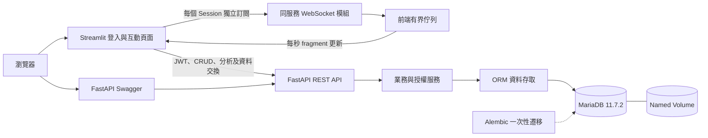
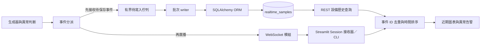

# DataPulse 架構與責任邊界

同一個 FastAPI 服務提供 REST API、WebSocket、模擬生成器與批次 writer。Streamlit 提供登入、角色感知的 CRUD、即時圖表與異常告警，以及已落庫資料的分析、匯入與匯出；MariaDB 保存使用者、CRUD 記錄及獨立的監測歷史。

## 模組範圍

| 模組 | 責任 |
| --- | --- |
| `api` | HTTP 輸入、REST 路由、依賴注入、回應狀態碼與 OpenAPI 文件 |
| `services` | 認證、角色與資料擁有權規則、業務流程及交易邊界 |
| `repositories` | 透過 SQLAlchemy ORM 執行資料存取；不自行 commit |
| `models` / `schemas` | ORM 資料結構與 Pydantic 輸入／輸出結構 |
| `db` | asyncmy、AsyncEngine 連線池、Session factory、資料庫健康檢查 |
| `core` | 環境設定、JWT、密碼雜湊、錯誤及結構化日誌 |
| `lifespan` | 建立及釋放資源，統一啟停生成器、writer 與 WebSocket 管理器 |
| `ws` | 連線認證、分類篩選、獨立發送佇列、斷線與慢速連線清理 |
| `realtime` | 不可變事件、事件分派、模擬生成與批次持久化 |
| `frontend/clients` | 使用容器內 API URL 查詢後端；不直接連接資料庫 |
| `frontend/state` | 每個登入 Session 的 token、角色、接收器與有界圖表資料 |
| `frontend/views` / `components` | 原生 Streamlit 表單與導覽、角色感知 CRUD、Altair 圖表及異常告警 |

前端容器透過 `API_BASE_URL=http://backend:8000` 呼叫後端。`PUBLIC_API_URL` 保留給公開連結整合，預設是宿主機的 `http://localhost:8010`；Swagger 可由 README 入口開啟。Streamlit 預設對宿主機開放 `8510`，兩者皆可由環境設定調整。

## 分析與資料交換

分析、歷史明細與匯出共用資料來源及篩選規則；所有角色可分析個人新增／匯入資料及系統設備歷史。個人分析由介面固定套用登入者 ID；系統資料以設備 ID 篩選，分類比較亦依設備分組。設備原始歷史由監控 API 開放所有登入者查詢。統計使用 ORM aggregate／group by 在資料庫完成，分析交易內依序查詢總計、分類與時間桶。前端只負責呈現統計結果，並將繪圖用值轉成數值；表格、API 與 Excel 保留精確小數。

匯入先驗證角色，再限制上傳大小、解析及逐列驗證。全部通過後才在單一 ORM 交易新增記錄；任何驗證或寫入錯誤均不留下部分資料。CSV／JSON 解析及 Excel 組裝在背景執行緒進行，資料庫操作維持 asyncmy。匯出有筆數上限，超過時要求使用者縮小查詢；詳見 [分析與資料交換](analytics.md)。

## 資料與權限

- 公開註冊固定建立 `user`，不接受使用者指定角色。
- `viewer` 可讀；`user` 可新增，並修改／刪除自己的記錄；`admin` 可修改／刪除所有記錄。
- 目前所有已登入使用者可讀取所有一般資料。若增加租戶或私人資料，須同時更新列表、明細、分析及推送的授權範圍。
- 模擬設備資料另存於 `realtime_samples`，不隸屬使用者，也不經過一般 CRUD 更新。所有已登入角色能接收設備事件及透過 `/monitoring/samples` 查詢歷史；管線狀態與原管理歷史 API 保持 Admin 限定，設備分析與匯出開放所有登入者。
- JWT 登出透過使用者 token version 撤銷該帳號所有既有 token。每次驗證讀取目前使用者狀態與角色。
- Service 擁有交易；每個請求的資料操作使用獨立、短生命週期 Session。資料庫存取不使用手寫 SQL。
- Schema 由 Alembic 管理；應用啟動不執行 `create_all()`。

## Admin 與日誌

第五階段管理端點使用相同 JWT 與角色規則。使用者權限變更先按 ID 順序鎖定操作者與目標，再檢查最新身分；更新、Token 版本遞增與 `system_logs` 的管理紀錄在同一筆交易提交。前端角色變更後清除管理輸入；登入失效或切換帳號時清除分析狀態。

一般應用日誌由 lifespan 持有的獨立有界 writer 批次保存；與即時樣本 writer 使用不同佇列。日誌故障不阻塞一般請求，關閉時先移除 handler 再限時排空。資料庫監控使用 ORM 計數與 SQLAlchemy Pool 資訊，日誌有定期保留上限。詳見 [Admin 設計與限制](admin.md)。

## WebSocket 與即時流程

`app/ws` 負責連線、設備／分類過濾與推送，與 REST 共用認證服務。`app/realtime` 負責固定設備目錄、持續生成、事件分派與批次 writer。公開事件包含穩定的 UUID 與設備 ID，推送與入庫時沿用相同值；名稱、單位與閾值一同保存為快照。模擬器每秒為 3 台設備各產生一筆，與是否有訂閱者無關。

推送與持久化各自收到事件，不競爭消費同一個普通佇列。持久化佇列滿時會對生成器施加背壓；每個 WebSocket 連線另有獨立發送佇列，連線太慢時只關閉該連線。WebSocket 不長期持有 Session，握手及持續驗證使用短生命週期資料庫存取。

writer 每次交易先查詢已存在的 `event_id`，將新事件組成 ORM 物件並批次提交。可重試的連線錯誤保留原批次，以有限退避間隔重試；不可恢復錯誤使任務失敗並反映到健康與狀態端點。事件送出時標示 `pending`，已提交與否以歷史查詢為準。

正常關閉順序為停止生成器 → 限時排空 writer → 關閉 WebSocket → 釋放資料庫 Engine。超過排空期限時會報告未確認事件數量，不會把未提交資料當成完成。Streamlit 接收器依 Session 管理，背景接收器只操作執行緒安全佇列，頁面執行緒負責圖表。暫停、換頁或登出時停止接收；無畫面更新超過 30 秒時以閒置期限釋放連線。

初版部署固定單一 worker。增加 worker 前，須先解決跨程序廣播與生成器唯一性。記憶體佇列不提供崩潰後恢復，資料庫 volume 只保護已保存的資料；若要求接收後不可遺失，需要持久化事件通道及確認機制。

監控頁先訂閱，再讀取該設備最近 300 筆歷史，約每 5 秒重新對照已提交資料，避免只顯示登入後接收的事件。較早資料集中於資料分析分頁查詢，監控頁提供帶入目前設備的入口。暫停畫面、離開頁面或登出只影響該 Session，模擬設備繼續生成。詳見 [設備監控與歷史接續](device-monitoring.md)。
