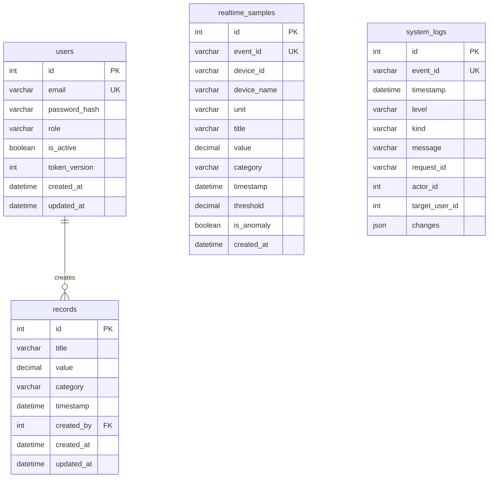

# 資料模型

使用 MariaDB 11.7.2、SQLAlchemy ORM、asyncmy 與 Alembic。容器的資料目錄掛載 named volume。業務資料存取只經 ORM；結構變更使用 Alembic schema 操作。

## `users`

| 欄位 | 定義與用途 |
| --- | --- |
| `id` | 自增整數主鍵 |
| `email` | 最長 320 字元，正規化後唯一 |
| `password_hash` | 最長 255 字元；只保存 Argon2 雜湊，不回傳 API |
| `role` | `admin`、`user` 或 `viewer`；註冊固定為 `user` |
| `is_active` | 是否可使用系統 |
| `token_version` | 登出或 Admin 實際改變角色／啟用狀態時遞增，撤銷該使用者所有較舊 JWT |
| `created_at` / `updated_at` | UTC、微秒精度時間 |

## `records`

| 欄位 | 定義與用途 |
| --- | --- |
| `id` | 自增整數主鍵 |
| `title` | 最長 200 字元，去除首尾空白後不得為空 |
| `value` | `DECIMAL(18, 6)`；有限數值，API 以字串回傳以保留精度 |
| `category` | 最長 100 字元，去除首尾空白後不得為空 |
| `timestamp` | 事件時間；輸入須有時區，轉成 UTC 保存 |
| `created_by` | 外鍵連至 `users.id`，由已登入使用者決定，禁止由請求指定 |
| `created_at` / `updated_at` | 系統建立及最後修改時間，UTC、微秒精度 |

記錄依擁有者以外的角色規則授權。外鍵使用 `RESTRICT`，避免刪除使用者時默默刪除其資料。系統管理以停用／啟用管理帳號，保留帳號與資料擁有權。

## `realtime_samples`

第二階段將系統生成的不可變測量快照獨立保存，不修改原本的 CRUD 表或擁有權規則。

| 欄位 | 定義與用途 |
| --- | --- |
| `id` | 資料庫自增整數主鍵，持久化之後才存在 |
| `event_id` | 36 字元 UUID，生成時決定，唯一約束防止重試重複寫入 |
| `device_id` / `device_name` | 固定設備 ID（64 字元）與事件當下名稱（100 字元）；舊資料為 `legacy`／舊版未指定設備 |
| `unit` | 事件當下單位，最長 16 字元；新溫度資料為 `°C`，舊資料留空 |
| `title` / `category` | 最長 200／100 字元的標題與分類 |
| `value` / `threshold` | `DECIMAL(18,6)`，保存測量值與當時使用的閾值 |
| `timestamp` | 事件產生時間，UTC、微秒精度 |
| `is_anomaly` | 當時的 `value > threshold` 結果 |
| `created_at` | ORM 建立持久化記錄的 UTC 時間 |

此表沒有使用者外鍵，沒有對外新增／更新／刪除 API。所有登入者透過 `/api/v1/monitoring/samples` 查詢設備原始歷史；Admin 另有 `/api/v1/monitoring/history` 管理入口。可依設備、分類、事件 ID、時間、異常狀態與分頁查詢。`0004_sample_devices` 只新增設備欄位與索引，保留原有樣本、使用者及 CRUD 記錄。設備目錄目前由程式固定定義 3 台模擬設備，不包含設備管理 CRUD。

batch writer 使用 ORM 查詢已有事件 ID，再將尚未保存的事件以 `add_all()` 加入同一個交易。相同批次內也會去重；`event_id` 是確認重送的依據，不依數值或時間猜測是否重複。

監測歷史索引為 `(timestamp, id)`、`(category, timestamp, id)`、`(device_id, timestamp, id)`，另有 `event_id` 唯一約束。歷史列表固定以 `timestamp DESC, id DESC` 排序，時間範圍同樣採半開區間。管理 history 每頁最多 100 筆，監控 samples 最多 300 筆供圖表初始化與同步；查詢筆數與資料使用同一個 REPEATABLE READ 快照。

`0005_sample_feed_index` 增加 `(device_id, id)` 索引，既有資料保持原樣。監控畫面改用 `sample-feed`：首次按 ID 取得最近提交的最多 300 筆，之後以 `id > after_id` 遞增讀取新提交，不使用 `COUNT` 或 `OFFSET`。原有 samples/history API 的時間排序及分頁維持不變。ID 游標仰賴目前單一 writer 依序提交的部署限制，增加平行寫入者前需重新評估提交順序。

## `system_logs`

第五階段的 `system_logs` 由 `0003_system_logs` 建立。一般日誌以唯一 `event_id` 避免不確定提交結果重試造成重複；管理操作紀錄直接參與使用者變更交易。`actor_id` 與 `target_user_id` 是稽核識別值，不設外鍵；角色／啟用狀態的前後值保存在 JSON `changes`，不包含密碼或 Token。

日誌有 `(timestamp, id)`、`(kind, timestamp, id)`、`request_id`、`actor_id` 索引。背景 writer 定期保留最新 10,000 筆，批次期間可能暫時超過上限；此限制同樣適用管理操作紀錄。所有寫入、去重、查詢及清理均使用 SQLAlchemy ORM。

## 時間、查詢與索引

MariaDB `DATETIME(6)` 保存不帶時區的 UTC 值；API 輸入要求明確時區，輸出標示 UTC。時間篩選採半開區間 `start_time <= timestamp < end_time`。相同排序值以 `id` 提供穩定次排序。

時間轉換後限制為 UTC 年份 1000–9999；超出範圍或轉換溢位會回傳 422，不交由資料庫拒絕。

預期索引為 `(timestamp, id)`、`(category, timestamp, id)`、`(created_by, id)`；email 另有唯一約束。列表限制每頁最多 100 筆，排序欄位採白名單。

遷移版本與 ORM metadata 應保持一致。新增或修改欄位時，建立遷移並檢查產生的操作；正式保留資料的環境應先備份，再評估結構變更。整合測試使用獨立、名稱結尾為 `_test` 的 MariaDB 資料庫。
