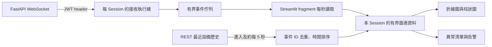

# Streamlit 前端

前端使用 FastAPI REST API 與 WebSocket，提供登入／登出、資料 CRUD、即時圖表及異常告警。第四階段增加資料分析、CSV／JSON 匯入與 Excel 匯出。前端不直接連線 MariaDB，也不自行判定使用者擁有資料的權限；最後授權與資料驗證仍由後端執行。

時間政策：系統使用現行台灣標準時間，所有日期固定 UTC+08:00；不套用歷史夏令時間。資料庫與 API 保留 UTC 時間點。

## 使用流程

| 頁面／操作 | 行為 |
| --- | --- |
| 登入 | 使用 email 與密碼取得 JWT，再讀取目前使用者與角色 |
| 註冊 | 建立一般 User 帳號；無法自行指定 Admin 或 Viewer |
| 即時監控 | 選設備後載入最近歷史、合併即時事件，更新數值、趨勢與異常清單 |
| 設備切換 | 使用固定設備 ID 訂閱，避免不同設備的數值混為一條曲線 |
| 暫停更新 | 關閉目前接收器並保留畫面；設備持續生成，恢復時同步最近歷史 |
| 歷史查詢 | 集中在資料分析；所有登入角色皆可依來源、設備及時間分頁查詢 |
| 資料管理 | 搜尋、篩選、排序、分頁、查看記錄；依角色提供新增、編輯、刪除 |
| 批次匯入 | User／Admin 上傳 CSV／JSON，明確提交後匯入；錯誤列會顯示在表格 |
| 資料分析 | 切換我的資料／系統監控資料，設備 A／B／C 下拉選單，查詢統計、趨勢及歷史明細 |
| Excel 匯出 | 產生目前查詢條件的明細檔，修改條件後必須重新產生 |
| 系統管理 | Admin 專用；使用者／角色、日誌、資料庫狀態，歷史入口導向資料分析 |
| 登出 | 呼叫後端撤銷 token，關閉接收器並清除本 Session 的登入與資料狀態 |

資料表中的 `value` 保留十進位字串精度；圖表為可視化轉換為數值，浮動提示保留原始十進位字串。事件時間、圖表軸、提示、管理日誌與 Excel 均使用台灣時間（UTC+8）。新增／編輯與時間篩選使用日期選擇器與「時／分／秒」下拉框；介面將台灣時間轉成帶時區的 API 值，資料庫仍以 UTC 保存。圖表固定以台灣時鐘座標顯示，不受瀏覽器或容器的本地時區影響。

一般 CRUD 分類使用設備 A／B／C 選單（保存 `device-001`／`device-002`／`device-003`），搜尋與編輯使用相同設備範圍。舊自由分類資料可透過舊分類條件查詢；不會自行推測設備。數值欄位驗證有限的十進位數字，保留最多 12 位整數與 6 位小數；不經 JavaScript 浮點數轉換，以免大數精度流失。CSV／JSON 由後端套用相同分類、數值與時間規則，任何一列不合法就整批拒絕。

一般 CRUD 記錄和設備監測快照是兩種資料來源。新增一般記錄不會產生設備事件；監控頁面的暫停、離開或重新整理也不會刪除一般記錄或已提交的監測歷史。

分析頁預設「我的資料（新增／匯入）」，固定以登入者 ID 篩選；所有角色皆可切換「系統產生的監控資料」。設備選單與資料管理共用設備 A／B／C 定義，另有全部設備及明確標示的舊資料入口。統計、圖表、分頁歷史與 Excel 共用已套用的時間、設備、標題條件；系統來源另支援異常狀態及事件 UUID。切換來源或設備會立即清除舊結果、下載及頁碼，其他表單條件提交後才套用。分析只讀已提交資料，無資料時顯示空狀態。統計／下載不使用全域快取；結果與下載檔僅屬於當前 Session，登出清除。統計、歷史與下載是獨立查詢，資料變動時可能存在時間差。

批次匯入一次最多 2 MiB、5,000 筆，任一列錯誤即整批拒絕。重複提交仍是另一批新增；無法確認網路請求結果時應先查詢，避免重複寫入。詳細格式、權限、精度及錯誤語意見 [分析與資料交換](analytics.md)。

## 角色與登入狀態

| 角色 | 一般記錄 | 即時監控 |
| --- | --- | --- |
| Viewer | 可讀取；沒有新增、編輯、刪除控制項 | 可查看即時資料、歷史、統計及匯出 |
| User | 可讀取、新增；僅可編輯與刪除自己的記錄 | 可查看即時資料、歷史、統計及匯出 |
| Admin | 可讀取、新增、編輯與刪除所有記錄 | 可查看即時資料、歷史、統計及匯出；另可管理管線 |

JWT、使用者資訊、接收器與圖表緩衝區只放在各自的 `st.session_state`；不使用全域快取共享。JWT 不寫入網址、瀏覽器 local storage 或持久化檔案。重新載入瀏覽器頁面會建立新的 Streamlit Session，需要重新登入。

每次完整頁面重新執行都會透過 `/users/me` 確認目前角色與帳號狀態。若登出時後端不可用，前端仍會停止接收器並清除本機狀態，同時提示伺服器端撤銷尚未完成；這種情況不能宣稱其他視窗的 token 已被撤銷。

暫停監控時雖然已關閉 WebSocket，畫面仍每秒執行 fragment，並約每 5 秒透過 `/users/me` 嘗試重新驗證；帳號在其他視窗登出或被停用時，不必等到原 JWT 到期才清除畫面。若驗證暫時失敗，會隱藏監控資料並保留待確認狀態，直到後續驗證成功；收到 `401` 則清除整個登入 Session。

API 回覆 `401` 或 WebSocket 回報認證失效時，前端結束登入狀態並清除圖表資料。`403` 是操作權限不足，不等同於登入失效。登出會撤銷同一帳號所有已發出的 token，因此同帳號其他視窗也會失去存取權。

前端按鈕的隱藏或停用只改善操作體驗，無法取代後端授權。即使角色在另一處變更，後端仍會使用最新角色與擁有者資料拒絕不允許的操作。

系統管理頁每次只查詢所選區域，不快取管理 API 回應。使用者角色／啟用狀態修改需明確勾選確認，並在每次顯示編輯器時讀取最新明細；自身帳號不顯示編輯表單。篩選或分頁改變時清除不適用的選取，查詢失敗不沿用舊資料。

Admin 權限消失時，前端清除 `admin_*` Session 狀態；系統歷史分析對所有登入者開放。實際管理變更會使目標帳號舊 Token 失效，後續 401 會清除整個登入。切換登入帳號也會清除前一位使用者的分析條件及結果。查看 [Admin 操作與驗收](admin.md) 可了解日誌延遲、保留上限及資料庫離線行為。

## 即時資料如何更新



WebSocket 是由 Streamlit 伺服器端建立，因此可以傳送 `Authorization: Bearer ...` header。瀏覽器只與 Streamlit 介面互動，不會將 token 放入 WebSocket 查詢參數。

接收執行緒只處理網路、訊息驗證與執行緒安全的佇列，不呼叫 Streamlit UI 或修改 Session State。UI 透過 `st.fragment(run_every=1)` 定期取出資料並更新圖表，因此不需要阻塞式迴圈或每秒重跑整個資料編輯頁面。

一般重新執行頁面會沿用目前的接收器；切換設備、進入資料分析、暫停或登出則停止舊連線。進入即時頁面時先建立訂閱，再載入最近 300 筆已保存資料，約每 5 秒重新查詢並與即時事件去重排序。按「查看歷史與分析」會帶入目前設備及系統來源。切換到資料管理會停止接收；返回監控頁或重新登入時同步歷史，因此仍能看到離開期間已保存的內容。當瀏覽器關閉或不再更新監控頁，預設 30 秒的閒置期限會釋放連線。上述操作皆不停止後端模擬設備。

資料管理的篩選輸入在切換頁面後仍保留，避免表單條件與實際查詢不一致。編輯標題後，選取清單會保留同一筆 ID 並更新標籤；已刪除的記錄則清除選取。

接收佇列預設最多 300 筆，UI 緩衝區最多保留 300 筆。畫面可選擇顯示最近 30、120 或 300 筆；異常清單顯示該範圍內最近 20 筆異常。數量與告警不代表資料庫的歷史總數。更早資料使用資料分析的時間篩選及分頁查詢，無須一次載入全部內容。

## 異常、斷線與緩衝區

| 情境 | 介面與資料行為 |
| --- | --- |
| 超過閾值 | 依事件的 `value > threshold` 標記；折線圖顯示紅色點，柱狀圖及告警清單標示異常 |
| 等於閾值 | 不視為異常 |
| 暫時斷線 | 顯示重連狀態並重試；REST 同步最近已保存資料，失敗時顯示歷史同步狀態 |
| 長時間資料缺口 | 同設備／分類相鄰事件相差超過 10 秒時分段，不將缺口畫成連續趨勢；較早內容由資料分析查詢 |
| Token 過期／撤銷 | 停止重試，清除登入與圖表狀態，要求重新登入 |
| 佇列滿載 | 丟棄較舊的待顯示事件並揭露省略數量；畫面緩衝區也有上限 |
| 不合法事件 | 不加入圖表，停止目前接收器並顯示錯誤狀態，不將錯誤 payload 或 token 顯示給使用者 |

告警是目前畫面範圍內的異常資料提示，不是簡訊、email、聲音或背景通知服務。歷史查詢的告警也只代表該查詢頁面的資料範圍。

**即時收到不代表已完成入庫。** WebSocket 事件的 `persistence` 為 `pending`，不另推送提交確認。REST 回傳的是已提交樣本；前端使用獨立解析器標示為 `committed` 並合併，同 ID 的歷史與即時事件不重複顯示。定期同步最近 300 筆不等於無限重播，更早資料仍由歷史查詢取得。任一登入角色可使用 `/monitoring/samples` 或 [命令列驗收](demo.md#即時推送與歷史保存)。

## 啟動與測試

```bash
docker compose up --build -d
```

開啟 `http://localhost:8510`。前端容器的 `API_BASE_URL` 預設為 `http://backend:8000`，REST 與 WebSocket 都使用容器網路；`PUBLIC_API_URL` 保留給公開 API 連結整合，不影響容器內請求。Swagger 入口位於 README。

執行前端單元測試與 Streamlit AppTest：

```bash
uv run --project frontend pytest frontend/tests
```

或使用與 CI 相同的隔離容器：

```bash
docker compose -p datapulse-monitor-test -f compose.yaml -f compose.test.yaml --profile test run --build --rm --no-deps frontend-tests
```

第三階段：2026-11-08 本機與 Docker 前端 76 項測試皆通過；後端另有 87 項測試通過。Compose 入口已驗證登入、即時圖表、登出，瀏覽器 console 沒有錯誤；臨時 QA 帳號及記錄已清除。

第四階段：Docker 前端 **103 項**、後端 **144 項**全數通過。新增案例涵蓋分析篩選、UTC 趨勢缺口、空結果、匯入逐列錯誤、角色限制、同一 Session 重複內容防護、下載條件一致性與舊資料清除。分析指標使用 3＋2 欄排列並允許長數值換行，避免精確小數被省略號截斷。

第五階段：Docker 前端 **131 項**、後端 **200 項**全數通過。新增管理 API 客戶端與 Admin AppTest，涵蓋角色入口、僅載入選取分頁、查詢／分頁、權限失效清除、帳號變更確認、自我保護及錯誤狀態。實際瀏覽器驗證角色撤銷會退出即時監控、停用／啟用、操作日誌、資料庫狀態與異常歷史；儲存後使用新的表單與控制項識別，確保下一次操作必須重新勾選確認。1536 × 1024 與 390 × 844 畫面皆完成檢查；詳細結果見 [Admin 驗證](admin.md#已完成驗證)。

設備監控改版：Docker 前端 **184 項**、後端 **237 項**全數通過。新增設備過濾、歷史／即時去重與排序、已提交狀態合併、恢復同步、分頁及錯誤狀態測試。實際 Chromium 驗證新登入立即顯示 120 筆既有資料、設備切換、暫停期間持續入庫、恢復／返回接續、歷史分頁與異常篩選；1536 × 1100 桌面及 390 × 844 手機無水平溢出，console 無 error／warning。詳見 [設備監控驗證](device-monitoring.md#已完成驗證2026-11-08)。

測試包含 HTTP 錯誤與驗證、WebSocket 接收與斷線、Session 清理、角色可操作範圍，以及實際 Streamlit 表單／按鈕／頁面的互動。Mock 測試用於固定錯誤與邊界條件；下列煙霧測試則實際連到既有後端。

```bash
uv run --project frontend python scripts/frontend_smoke.py
```

此命令提示輸入 User 或 Admin 帳號，亦可使用 `DATAPULSE_EMAIL`／`DATAPULSE_PASSWORD`；不讀取 `.env` 或列印機密。它建立一筆唯一命名的 QA 記錄，驗證新增／讀取／修改／篩選／刪除，再接收即時事件，最後驗證登出同時撤銷 HTTP 與既有 WebSocket 連線。若執行中斷，會嘗試刪除 QA 記錄並關閉連線；清理失敗時只提示需要處理的記錄 ID。

煙霧測試會登出指定帳號並撤銷該帳號其他 token，建議使用獨立測試帳號。使用 `--api-url` 可指定其他位址，`--count` 調整接收數量，`--timeout` 調整等待期限。

2026-11-08 已對執行中的 Compose 服務完成此驗證：REST CRUD 與十進位數值一致、三筆真實 WebSocket 事件接收成功、QA 記錄刪除後回覆 `404`、登出後 REST 回覆 `401` 且既有接收器進入 `auth_failed` 並清空待顯示佇列。

### 台灣時間與資料管理驗收（2026-11-08）

| 項目 | 結果 |
|---|---|
| 自動測試 | Docker 後端 284 項、前端 232 項，共 516 項通過；Ruff／format 通過 |
| 時間一致性 | 監控顯示台灣時間；瀏覽器改為 America/Los_Angeles 後圖表仍維持台灣時鐘座標 |
| 新增 | 透過設備 B、2026-11-09 00:00:00 下拉框建立資料；API 保存 `device-002`、`2026-11-08T16:00:00Z`，`123456789012.123456` 精度完整 |
| 編輯與搜尋 | 改為設備 C、01:02:03 及新標題後，API 保存 `device-003`、`2026-11-08T17:02:03Z`；可依新設備與標題查到同一筆 |
| 非數字輸入 | `abc` 在表單顯示格式錯誤，資料筆數不增加 |
| 匯入驗證 | CSV 同時列出數值、設備分類及缺少時區三項錯誤，整批不寫入；JSON 拒絕與原子性亦以真實 API 及整合測試確認 |
| 時間邊界 | 台灣午夜、跨年、查詢半開區間、每日統計與 Excel `+08:00`；未改時間時保留原始微秒 |
| 路由 | 未登入直接開啟／重新載入 `/records` 可登入並返回頁面，無 Page not found 彈窗；非 Admin 的管理路由使用安全提示頁 |
| 畫面 | Playwright Chromium，`http://localhost:8510`；1536 × 1100 桌面及 390 × 844 手機，頁面標題／內容正常，無空白或錯誤覆蓋畫面，手機頁寬 390 |
| 主控台 | 直開子頁時 Streamlit 曾請求 `/records/_stcore/host-config`、`/records/_stcore/health` 得到 404，隨後成功登入及操作；另有部署重啟期間連線中斷訊息，無前端 Python 例外 |
| 清理 | 本次 QA 帳號、測試記錄、token 與隔離測試容器已清除；原有使用者、一般記錄及監控歷史保留 |

使用 Playwright CLI 的 `snapshot`、`run-code`、`resize`、`console warning` 完成驗收（本環境未提供 Browser plugin）。驗證限本機 Chromium 與上述尺寸，未宣稱所有瀏覽器皆已測試。

資料分析與歷史整合（2026-11-08）：Docker 後端 **353 項**、前端 **248 項**全數通過。來源／設備切換、本人資料範圍、分頁、異常與事件 UUID、共用匯出條件及導航均已驗證；真實桌面／手機介面無頁面溢出或框架錯誤，Console 0 errors／0 warnings。完整證據見 [分析整合驗收](analytics.md#資料來源與歷史整合驗收2026-11-08)。
